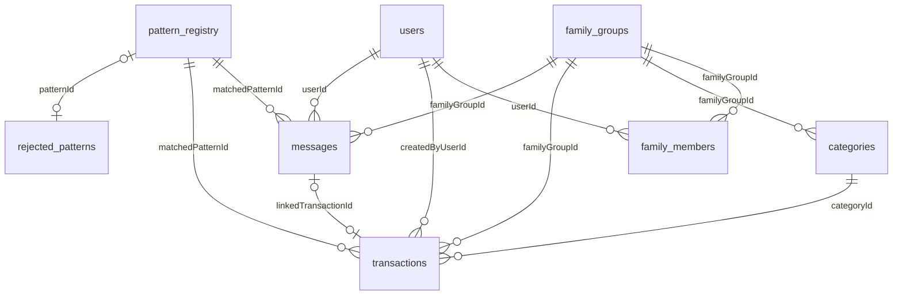
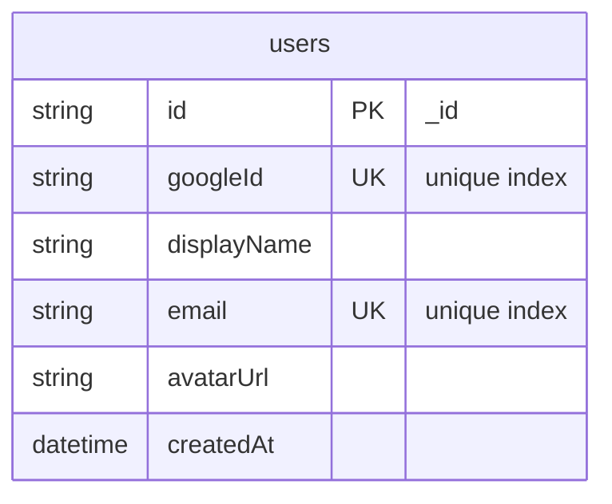
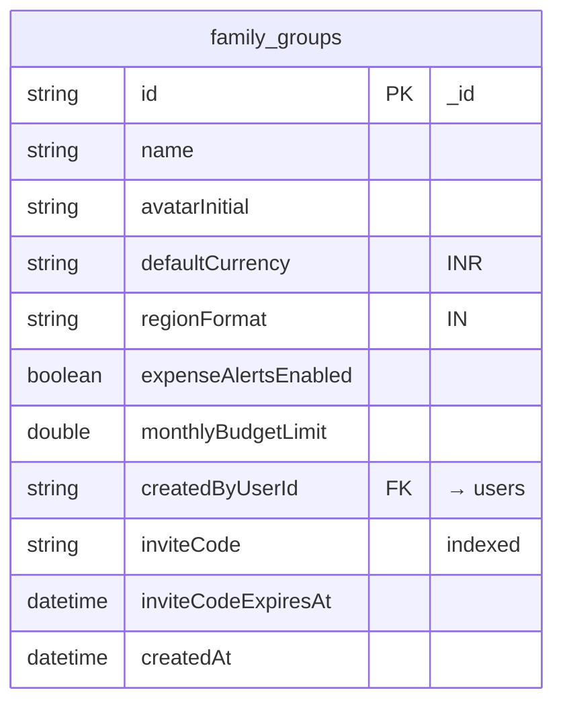
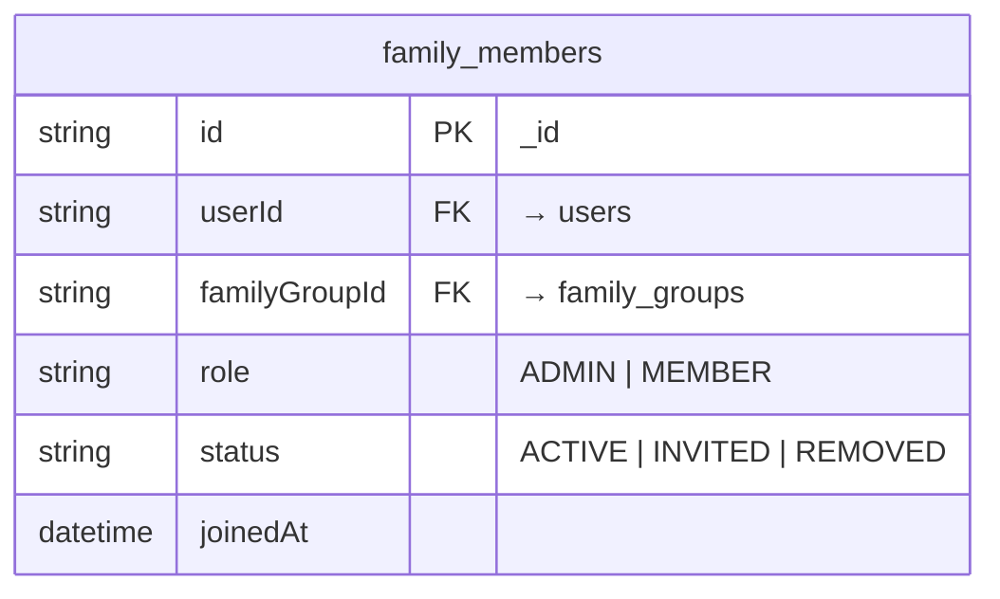
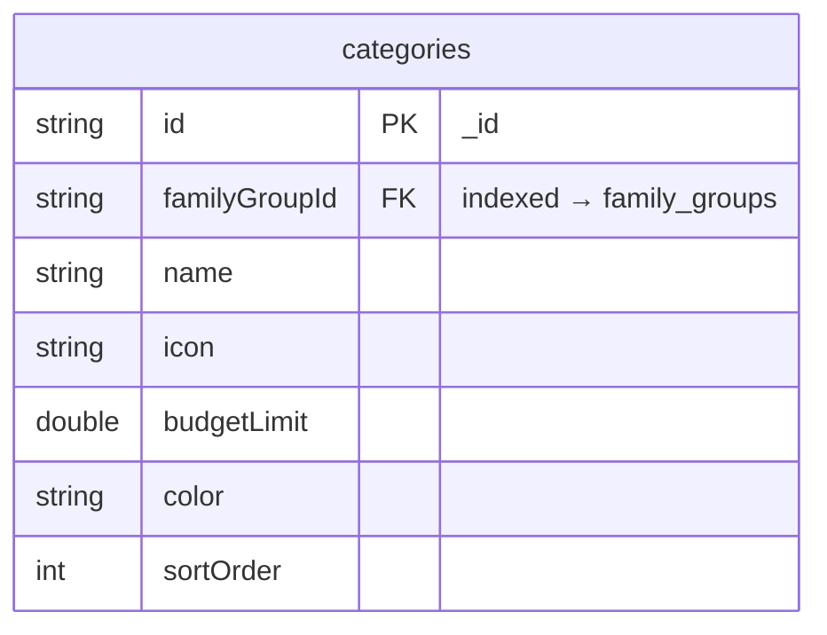
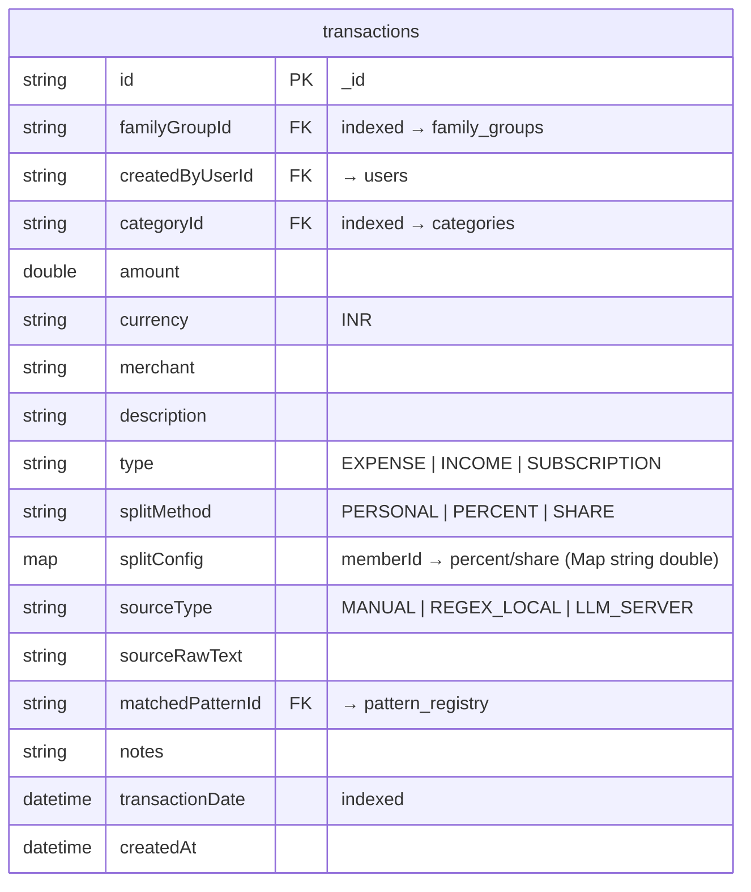
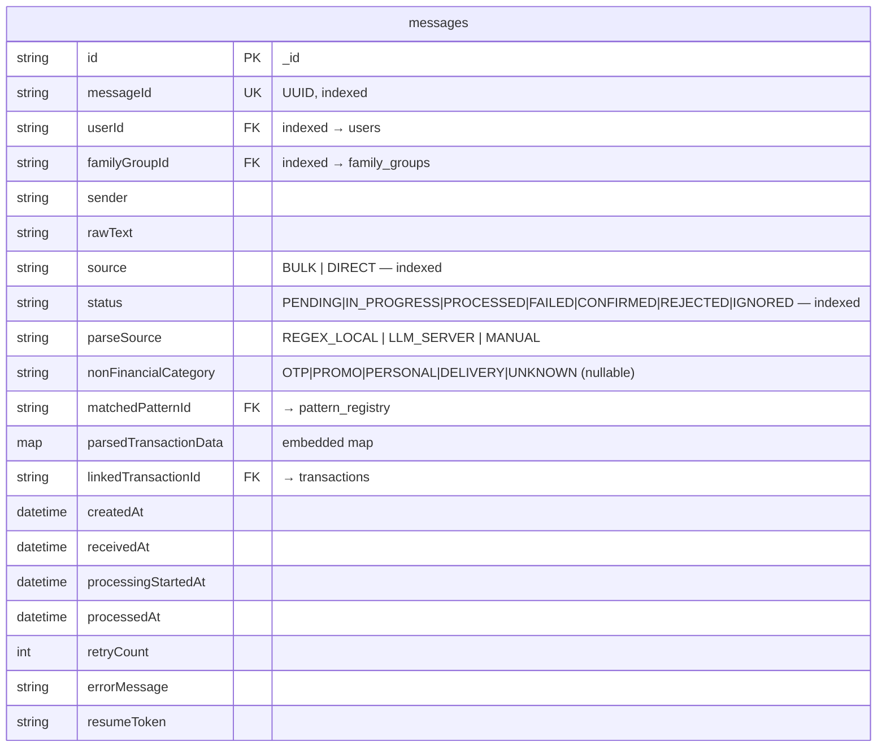
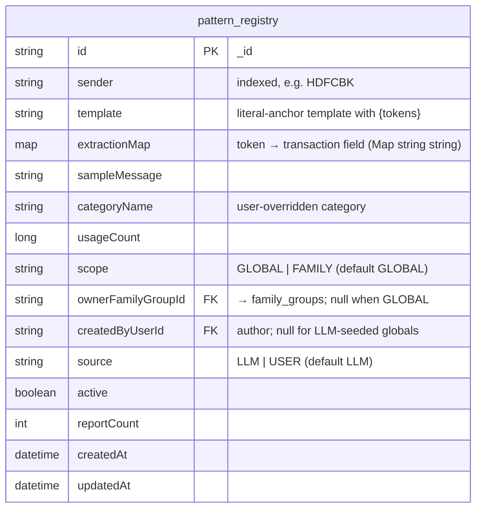
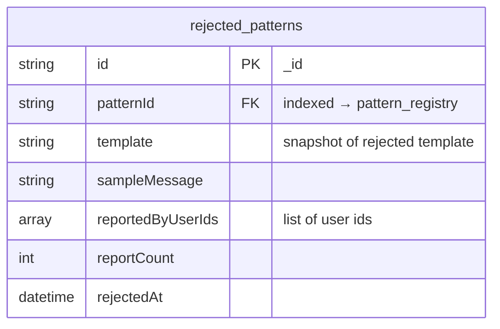
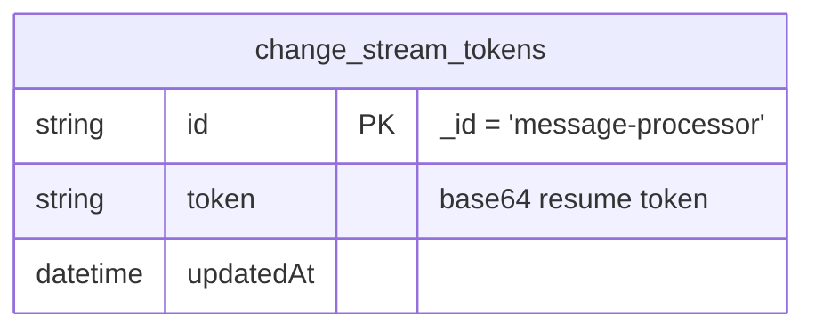

# Budgetly — Database Schema (ERD)

> **Database:** MongoDB 7.x (document store, run as a replica set `rs0` locally so change streams work).
> **Source of truth:** `budgetly_api/src/main/java/com/budgetly/api/document/*.java` (Spring Data MongoDB `@Document` classes).
> This document is maintained alongside every entity migration — see CLAUDE.md.

## Collections Overview

| Collection | Document class | Purpose |
|---|---|---|
| `users` | `UserDocument` | Authenticated Google users |
| `family_groups` | `FamilyGroupDocument` | Household / budget group |
| `family_members` | `FamilyMemberDocument` | Membership + role between user and family |
| `categories` | `CategoryDocument` | Per-family transaction categories |
| `transactions` | `TransactionDocument` | Expense / income / subscription records |
| `messages` | `MessageDocument` | Ingested SMS messages awaiting parsing/triage |
| `pattern_registry` | `SmsPatternDocument` | Learned literal-anchor templates per sender |
| `rejected_patterns` | `RejectedPatternDocument` | Templates reported/auto-disabled |
| `change_stream_tokens` | `ChangeStreamTokenDocument` | Change-stream resume token (idempotent restarts) |

MongoDB does not enforce foreign keys; relationships below are **logical** (string references to `_id` values).

## Entity-Relationship Diagram

## Collections

### `users`

### `family_groups`

### `family_members`

- Unique compound index `(userId, familyGroupId)` — a user can appear in a family only once.

### `categories`

### `transactions`

### `messages`

- Compound indexes: `(status, createdAt)`, `(userId, status)`, `(familyGroupId, status)`.
- `source` discriminates the two ingestion routes (see ADR-0003): `BULK` docs are consumed by the change-stream listener; `DIRECT` docs are processed synchronously by `POST /messages/process`.

### `pattern_registry`

- Compound index `sender_scope_owner_active_idx` = `(sender, scope, ownerFamilyGroupId, active)`, used by the family-aware registry lookup.
- `scope`/`ownerFamilyGroupId` partition the library: global patterns are readable by every family; `FAMILY` patterns are visible only to the owning family.
- Precedence when matching an incoming SMS (`findActiveBySender(sender, familyGroupId)`): **family-scoped patterns first** (newest `updatedAt`), then globals (newest `updatedAt`).
- Authored (`source = USER`) family patterns are validated against their `sampleMessage` before insert/update, may be promoted to `GLOBAL` by a family admin once `usageCount` reaches `pattern.promote-usage-threshold`, and stay read-only after promotion.

### `rejected_patterns`

### `change_stream_tokens`

## Notes

- **No separate JPA/SQL schema** — entities are MongoDB documents. There is no redundant mapping layer; controllers consume the generated OpenAPI models and map to/from documents in the service layer.
- The OpenAPI domain models (`api/budgetly-openapi.yml` / `budgetly_api/src/main/resources/api/budgetly-openapi.yml`) mirror these documents; see [design.md](design.md) for the mapping flow.
