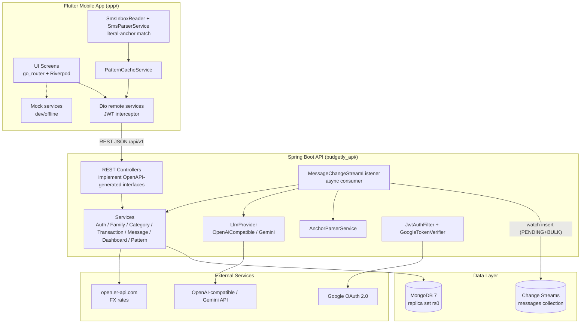
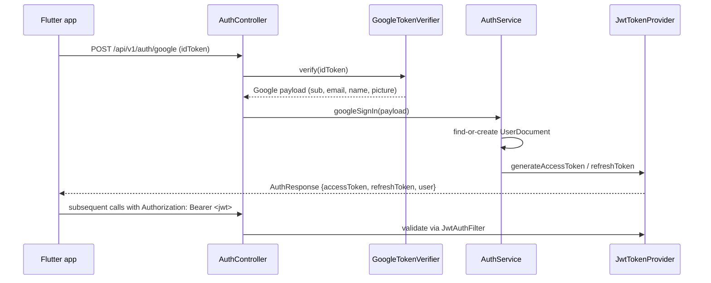
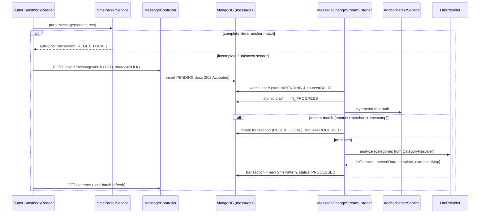
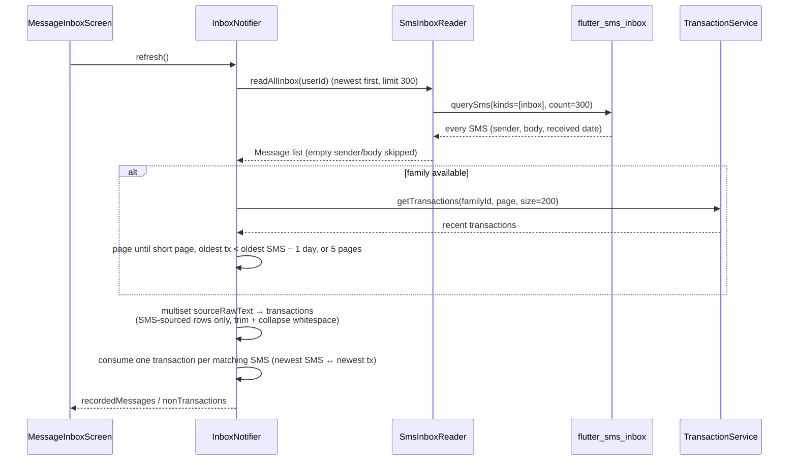
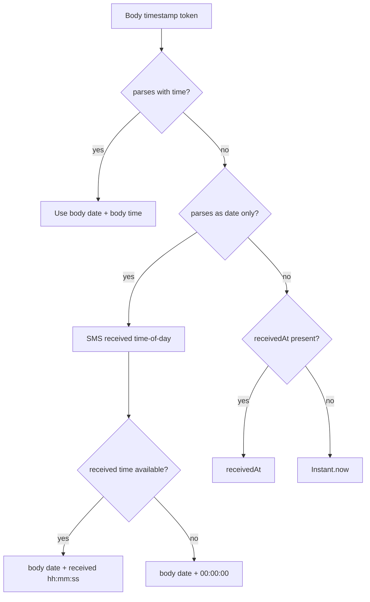
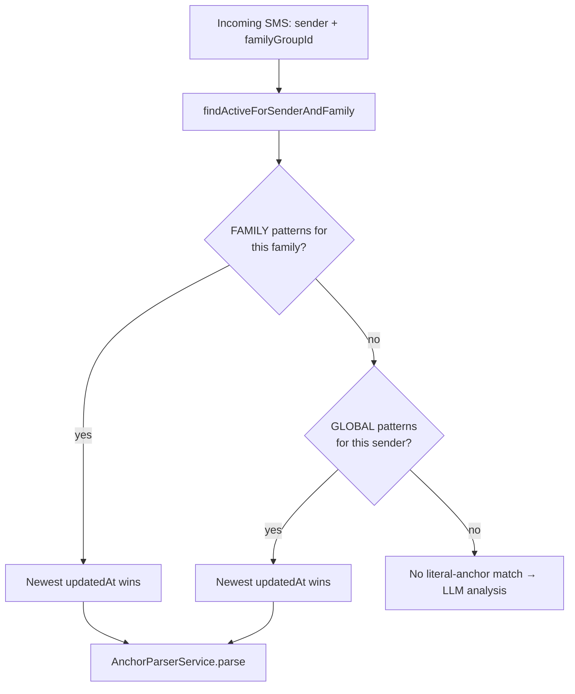
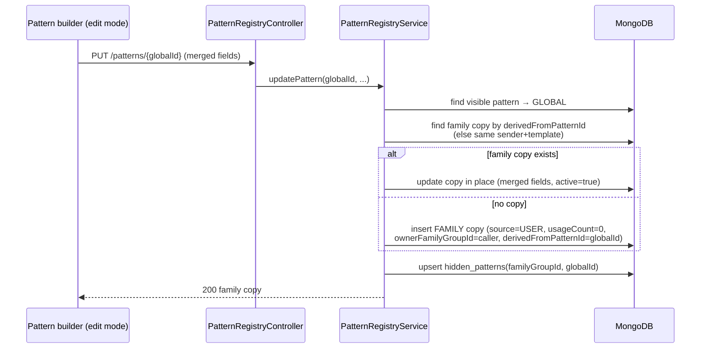
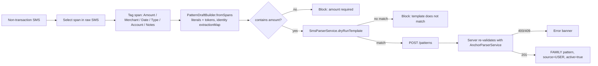
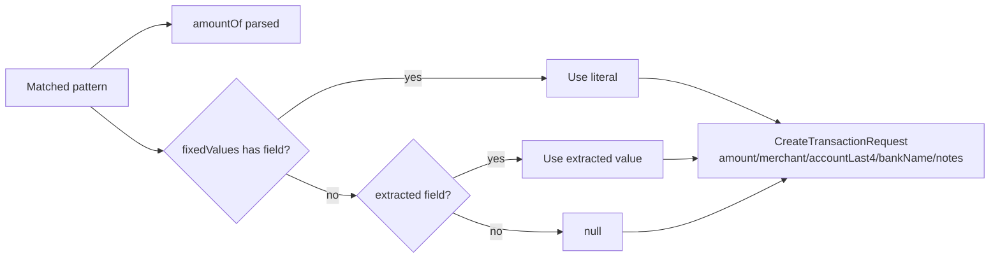

# Budgetly — System Design

> End-to-end design and component boundaries for the Budgetly family finance app.
> Companion documents: [requirements.md](requirements.md), [ERD.md](ERD.md), [TODO.md](TODO.md), and ADRs in [`doc/adr/`](doc/adr/).

## 1. Architecture Overview



### Components

| Component | Technology | Responsibility |
|---|---|---|
| Flutter app (`app/`) | Dart 3.11, Riverpod 3, go_router, Dio, google_sign_in | UI + on-device SMS parsing + API client |
| REST API (`budgetly_api/`) | Java 25, Spring Boot 4.1.2, SpringDoc, JJWT | Auth, CRUD, budget aggregation, message/pattern APIs |
| MongoDB | MongoDB 7 (replica set) | Document store + change-stream ingestion pipeline |
| LLM layer | `LlmProvider` → `OpenAiCompatibleLlmProvider` / `GeminiLlmProvider` | Server-side SMS classification + template generation |
| Pattern engine | `AnchorParserService` (Java) / `SmsParserService` (Dart) | Literal-anchor template matching (parity algorithm) |

## 2. Backend Package Layout

```
budgetly_api/src/main/java/com/budgetly/api/
├── controller/       # REST controllers implementing generated interfaces
├── service/          # Business logic + AnchorParserService, TransactionDateParser,
│                     #   CurrencyConversionService, CategoryResolver
├── repository/       # Spring Data MongoDB repositories
├── document/         # @Document entities (see ERD.md)
├── llm/              # LlmProvider interface, OpenAI-compatible + Gemini impls, prompt
├── listener/         # MessageChangeStreamListener (change-stream consumer)
├── security/         # JwtTokenProvider, JwtAuthFilter, GoogleTokenVerifier,
│                     #   GoogleAuthConfigValidator
├── config/           # SecurityConfig, MongoConfig, CorsConfig
├── health/           # MessageProcessorHealthIndicator
└── exception/        # GlobalExceptionHandler + typed exceptions
```

Generated OpenAPI interfaces/models land in `com.budgetly.api.generated.controller` / `...generated.model` during `mvn compile`.

## 3. Key Flows

### 3.1 Authentication (Google → JWT)



### 3.2 SMS Ingestion & Processing (bulk + change stream)



- Legacy `source=DIRECT` documents were completed synchronously when they were written and are never claimed by the listener (duplicate-processing race resolved — ADR-0003). The message triage endpoints (`/messages/pending`, `/messages/ignored`, `/messages/failed`, `/messages/{id}/confirm|reject|restore`, `/messages/process`) have been removed; bulk ingestion + the change stream is the only server-side message path.

### 3.3 Device inbox → two tabs (Recorded / Non-Transactions)

The app's message inbox mirrors the phone's SMS store rather than the server's message triage queue. `InboxNotifier.refresh()` reads every device SMS (`SmsInboxReader.readAllInbox`), then classifies each one by asking whether a recorded transaction carries the same normalized body:



- `Recorded Transactions` = SMS with a consumed transaction; tapping one opens `AppRoutes.transactionDetail` for that transaction. The card hands the transaction to the route via `extra`, because the inbox window (300 SMS) can reach further back than the feed's first page (20 transactions); the detail screen falls back to the paged `transactionProvider` list when no transaction is handed over.
- `Non-Transactions` = every other SMS (OTP, promo, personal, and parseable bank SMS not yet recorded). Each card shows sender, date-led timestamp, and body, with a single `Define pattern` action.
- Manual rows (`sourceType=manual`) and legacy transaction rows created before `sourceRawText` existed can never match, so views created from them appear under Non-Transactions. This is acceptable: the inbox mirrors the device, and those messages can still produce a pattern.
- Matching is one-to-one per normalized body. Two identical SMS bodies need two distinct transactions to both show as recorded; otherwise one stays under Non-Transactions.

### 3.4 Timestamp resolution (date-only SMS)



`TransactionDateResolver.resolve` (Dart) and `TransactionDateParser.resolveTransactionDate` (Java) implement the same rule: a body timestamp containing `\d{1,2}:\d{2}` wins completely; a date-only body keeps its date and borrows the received time-of-day; missing body or unparseable tokens fall back to the received time, then to now. The date is always the most important signal.

## 4. Literal-Anchor Parsing (no regex)

The pattern engine stores sender templates as literal text with `{token}` placeholders and matches by **left/right literal anchors** using `indexOf` on both Java and Dart — guaranteeing identical behavior across platforms. See [`plans/token_template_sms_parsing.md`](plans/token_template_sms_parsing.md) and the parity tests `AnchorParserTest` (Java) / `sms_parser_service_test.dart` (Dart).

### 4.1 Registry scope & match precedence

`pattern_registry` documents carry `scope` (`GLOBAL`/`FAMILY`), `ownerFamilyGroupId`, `createdByUserId`, and `source` (`LLM`/`USER`). LLM-seeded patterns are global; authoring through the builder creates a family-scoped `USER` pattern. Lookup for an incoming SMS resolves the owning family from the message and tries family patterns **before** globals, newest first within each scope:



- The on-device parser (`SmsParserService.parseMessage`) applies the same precedence — family first, newest `updatedAt` within a scope — before anchor-matching locally, so an authored family pattern and its fixed values are not shadowed by a newer global LLM pattern. It additionally filters to `matchablePatterns` (`active && !hiddenForFamily`), so a global hidden by the caller's family never parses on that device. When a matched pattern carries a `categoryName` override, the client loads the family's categories on demand to resolve it to a `categoryId` when it posts the transaction as `REGEX_LOCAL`.
- The registry viewer lists active globals minus the caller's hidden globals, plus every pattern owned by the caller's family (active and inactive). `GET /patterns` resolves the caller's family server-side, so another family's authored templates are never exposed.
- Any family member can act on a global: editing it creates a family copy and hides the global for that family only. Family patterns are edited/disabled by their author or a family admin. A family admin can promote a family pattern once `usageCount >= pattern.promote-usage-threshold`, after which it becomes `GLOBAL` and is shared by every family. There is no delete endpoint — patterns are disabled, and globals are hidden per family.

#### 4.1.1 Editing / disabling a GLOBAL: copy-on-write + hide marker

The family's registry row for a global is shared, so the server never mutates it. Editing first materializes a family copy, then hides the global for that family:



Ordering matters: the marker is written only after the copy exists, so a mid-flight failure can never leave the family with neither pattern. Repeating the edit updates the same copy. `POST /patterns/{id}/disable` follows the same split: `GLOBAL` → upsert marker; `FAMILY` → `active=false`. `POST /patterns/{id}/enable` reverses it; enabling a family pattern returns `409` when another active visible pattern shares its sender+template.

### 4.2 Highlight-and-tag pattern builder

Every non-transaction message carries a single `Define pattern` action that opens the builder prefilled with that SMS. The client derives the template, previews the match with the same anchor algorithm, and the server re-validates the effective `(template, sampleMessage)` pair before persisting:



- Manual edits to the template bypass the client dry-run but are still validated server-side (400 when no fields or no `amount` extract). This is the known gap for OTP/promo/personal SMS: `Define pattern` is offered on every non-transaction message, but a body with no amount cannot be saved and the builder surfaces the validation message.
- On create, a successful save also calls `SmsNotifier.recordLocally(message)`: the sync checkpoint means this SMS is never re-read by the background pipeline, so the source message is parsed against the fresh cache and posted immediately when complete. On edit the source message is not re-recorded (the pattern only changes future matching).
- Edit mode (`?patternId=`) prefills sender, sample, template, fixed values, and category from the registry. Span tagging is hidden because spans cannot be reconstructed from a stored template. Editing a GLOBAL shows "Customize for family" and saves as the copy-on-write flow in 4.1.1.
- Overlapping tagged spans are rejected client-side; the derivation is pure logic (`pattern_draft_builder.dart`) unit-tested independently of the widget.
- The builder also offers an optional **category override** (resolved per family by name at match time) and **fixed values** for Merchant / Account / Bank name / Notes. A fixed value is stored in `pattern_registry.fixedValues` and wins over the template-extracted value; an empty input uses the extracted value. `amount`, `timestamp`, and `type` are rejected as fixed values (they drive parsing), and promotion to `GLOBAL` clears `fixedValues` so family-specific literals do not leak into the shared library.

### 4.3 Pattern resolution at transaction time

The listener resolves each field with fixed-value precedence, then persists the result (including `accountLast4`, `bankName`, and `notes`) on the transaction:



## 5. API Contract (Contract-First)

- Canonical spec: `budgetly_api/src/main/resources/api/budgetly-openapi.yml`.
- `openapi-generator-maven-plugin:7.27.0` generates Spring interfaces (tags → `Auth`, `FamilyGroups`, `Categories`, `Transactions`, `Messages`, `PatternRegistry`, `Dashboard`) and DTO models; controllers implement those interfaces.
- SpringDoc serves Swagger UI (`/swagger-ui.html`) and OpenAPI JSON (`/api-docs`).

## 6. Configuration & Observability

- Runtime config: `application.yml`, `application-docker.yml`, `application-test.yml`.
- Key env: `GOOGLE_CLIENT_ID` (required), `JWT_SECRET`, `LLM_PROVIDER` (`openai` default / `gemini`), `OPENAI_*`, `SPRING_MONGODB_URI`, `BUDGETLY_CHANGE_STREAM_ENABLED`.
- Actuator: `/actuator/health`, `/actuator/prometheus`, `/actuator/metrics`.

## 7. Testing Strategy

| Layer | Tool | Notes |
|---|---|---|
| Backend E2E | RestAssured `*E2ETest.java` | Full `@SpringBootTest` context against embedded Flapdoodle MongoDB 7.0.9 (no Docker required) |
| Backend unit | JUnit + Mockito + Awaitility | `AnchorParserTest`, `MessageChangeStreamListenerTest`, service tests |
| Flutter | `flutter test` (`app/test/`) | Widget + provider + service + model tests (`mocktail`) |
| Release gate | E2E smoke tests | Per CLAUDE.md — run on the Android emulator before completion |

## 8. Decision Log

Architecture decisions are recorded as ADRs in `doc/adr/`:
- `0001-raw-google-oauth-and-custom-jwt.md` — raw Google OAuth 2.0 verification + custom JWT (no Firebase).
- `0002-contract-first-openapi-generation.md` — contract-first OpenAPI code generation (`openapi-generator-maven-plugin`).
- `0003-bulk-insert-change-stream.md` — bulk ingestion + change-stream consumer.
- `0004-upgrade-to-java-25-and-spring-boot-4.md` — Java 25 / Spring Boot 4.1.2 migration.
