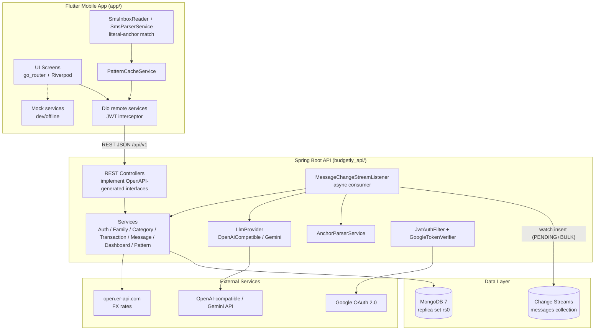
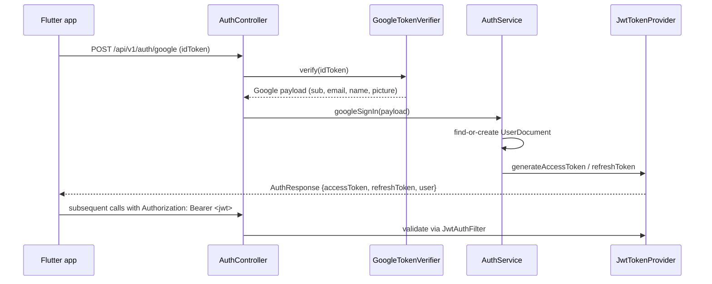
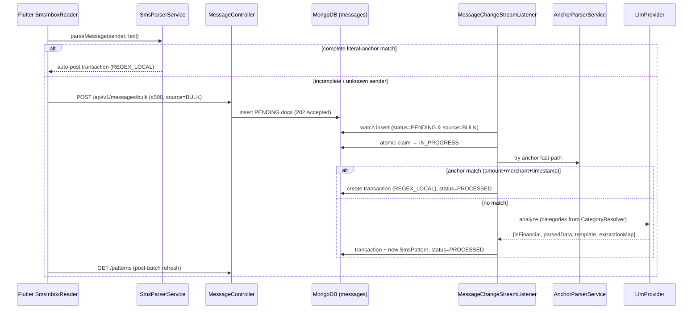

# Budgetly — System Design

> End-to-end design and component boundaries for the Budgetly family finance app.
> Companion documents: [requirements.md](requirements.md), [ERD.md](ERD.md), [TODO.md](TODO.md), and ADRs in [`doc/adr/`](doc/adr/).

## 1. Architecture Overview



### Components

| Component | Technology | Responsibility |
|---|---|---|
| Flutter app (`app/`) | Dart 3.11, Riverpod 3, go_router, Dio, google_sign_in | UI + on-device SMS parsing + API client |
| REST API (`budgetly_api/`) | Java 25, Spring Boot 4.1.2, SpringDoc, JJWT | Auth, CRUD, budget aggregation, message/pattern APIs |
| MongoDB | MongoDB 7 (replica set) | Document store + change-stream ingestion pipeline |
| LLM layer | `LlmProvider` → `OpenAiCompatibleLlmProvider` / `GeminiLlmProvider` | Server-side SMS classification + template generation |
| Pattern engine | `AnchorParserService` (Java) / `SmsParserService` (Dart) | Literal-anchor template matching (parity algorithm) |

## 2. Backend Package Layout

```
budgetly_api/src/main/java/com/budgetly/api/
├── controller/       # REST controllers implementing generated interfaces
├── service/          # Business logic + AnchorParserService, TransactionDateParser,
│                     #   CurrencyConversionService, CategoryResolver
├── repository/       # Spring Data MongoDB repositories
├── document/         # @Document entities (see ERD.md)
├── llm/              # LlmProvider interface, OpenAI-compatible + Gemini impls, prompt
├── listener/         # MessageChangeStreamListener (change-stream consumer)
├── security/         # JwtTokenProvider, JwtAuthFilter, GoogleTokenVerifier,
│                     #   GoogleAuthConfigValidator
├── config/           # SecurityConfig, MongoConfig, CorsConfig, AsyncConfig
├── health/           # MessageProcessorHealthIndicator
└── exception/        # GlobalExceptionHandler + typed exceptions
```

Generated OpenAPI interfaces/models land in `com.budgetly.api.generated.controller` / `...generated.model` during `mvn compile`.

## 3. Key Flows

### 3.1 Authentication (Google → JWT)



### 3.2 SMS Ingestion & Processing (bulk + change stream)



- The legacy synchronous path (`POST /messages/process`) stamps `source=DIRECT` and is never claimed by the listener (duplicate-processing race resolved — ADR-0003).

## 4. Literal-Anchor Parsing (no regex)

The pattern engine stores sender templates as literal text with `{token}` placeholders and matches by **left/right literal anchors** using `indexOf` on both Java and Dart — guaranteeing identical behavior across platforms. See [`plans/token_template_sms_parsing.md`](plans/token_template_sms_parsing.md) and the parity tests `AnchorParserTest` (Java) / `sms_parser_service_test.dart` (Dart).

## 5. API Contract (Contract-First)

- Canonical spec: `budgetly_api/src/main/resources/api/budgetly-openapi.yml`.
- `openapi-generator-maven-plugin:7.27.0` generates Spring interfaces (tags → `Auth`, `FamilyGroups`, `Categories`, `Transactions`, `Messages`, `PatternRegistry`, `Dashboard`) and DTO models; controllers implement those interfaces.
- SpringDoc serves Swagger UI (`/swagger-ui.html`) and OpenAPI JSON (`/api-docs`).
- ⚠️ Known drift: the root-level `api/budgetly-openapi.yml` is an older copy and the `PATCH /patterns/{id}/category` controller endpoint is not yet in the spec — see [TODO.md](TODO.md).

## 6. Configuration & Observability

- Runtime config: `application.yml`, `application-docker.yml`, `application-test.yml`.
- Key env: `GOOGLE_CLIENT_ID` (required), `JWT_SECRET`, `LLM_PROVIDER` (`openai` default / `gemini`), `OPENAI_*`, `SPRING_MONGODB_URI`, `BUDGETLY_CHANGE_STREAM_ENABLED`.
- Actuator: `/actuator/health`, `/actuator/prometheus`, `/actuator/metrics`.

## 7. Testing Strategy

| Layer | Tool | Notes |
|---|---|---|
| Backend E2E | RestAssured `*E2ETest.java` | Full `@SpringBootTest` context against embedded Flapdoodle MongoDB 7.0.9 (no Docker required) |
| Backend unit | JUnit + Mockito + Awaitility | `AnchorParserTest`, `MessageChangeStreamListenerTest`, service tests |
| Flutter | `flutter test` (`app/test/`) | Widget + provider + service + model tests (`mocktail`) |
| Release gate | E2E smoke tests | Per CLAUDE.md — run on the Android emulator before completion |

## 8. Decision Log

Architecture decisions are recorded as ADRs in `doc/adr/`:
- `0003-bulk-insert-change-stream.md` — bulk ingestion + change-stream consumer.
- `0004-upgrade-to-java-25-and-spring-boot-4.md` — Java 25 / Spring Boot 4.1.2 migration.
