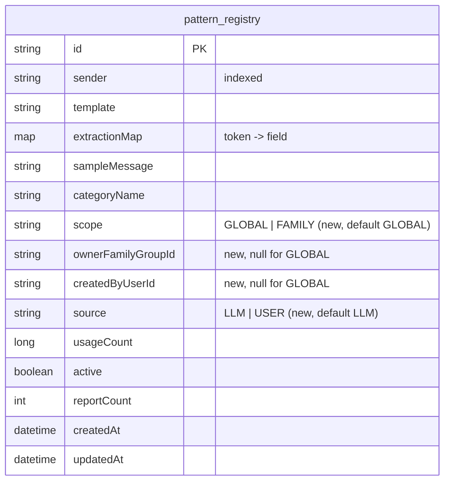
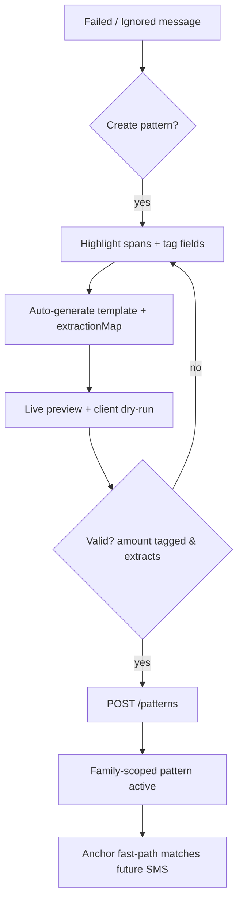
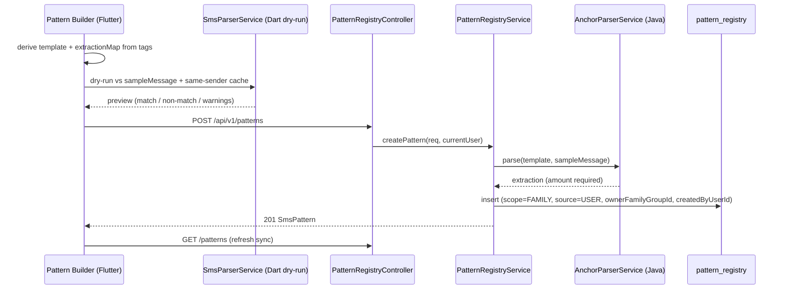

# Cached Pattern Registry Viewer + Custom Pattern Builder

> **Status (2026-11-21): Proposed.** Detailed requirements for letting users browse the
> cached pattern registry and author their own literal-anchor patterns from failed/ignored
> SMS messages, using the same canonical `{token}` vocabulary the `AnchorParserService`
> already understands. Not yet implemented — see `development_plan.md` for the roadmap hook.

## 1. Problem & Goals

Today the pattern registry (`pattern_registry` collection) is populated **only** by the LLM
first-sighting path: when the server's anchor fast-path misses, the LLM returns a `template` +
`extractionMap` that becomes a new `SmsPattern`. Users can only *report* a pattern
(`POST /patterns/{id}/report`) or *override* its category (`PATCH /patterns/{id}/category`).
There is no way to:

1. **See** what patterns are cached for their family.
2. **Recover** a message that failed to parse (technical `FAILED`) or was classified
   non-financial (`IGNORED`) but is actually a real transaction.
3. **Author** a pattern themselves — teaching the anchor parser a sender/template the LLM
   got wrong, without waiting for the LLM to learn it.

### Goals
- **G1** — Let users browse cached patterns (sender, template, sample, usage, active status).
- **G2** — Let users create a pattern from a failed/ignored message by *highlighting spans*
  and tagging them with standard fields (no template syntax knowledge).
- **G3** — Keep authored patterns **family-scoped** and validated before going live, so a bad
  pattern never corrupts the shared global library.
- **G4** — Reuse the existing literal-anchor engine and `extractionMap` contract unchanged —
  a user-authored template is byte-for-byte the same shape the LLM produces today.

## 2. Scope Decisions (agreed)

| Decision | Choice |
|---|---|
| **Pattern scope** | **Family-only** by default. Authored patterns are private to the author's family group and may be **promoted to the global library** (admin) after successful use. |
| **Builder UX** | **Highlight & tag** — select a span in the raw SMS and tag it with a field; the app derives the template + `extractionMap`. |
| **Source messages** | **Failed + Ignored** — add a `GET /messages/failed` surface and expose "Create pattern" on both failed and ignored (non-financial) message cards. |
| **Validation** | **Preview + validate** — client dry-run (Dart parity) + server re-validation on save; block on missing amount or non-extracting template; warn on weak/ambiguous anchors. |

## 3. Standard Token Vocabulary (the "standard patterns")

The anchor engine extracts values for canonical fields. Users tag spans against this fixed
vocabulary — the token name **equals** the field name, so `extractionMap` is effectively 1:1:

| Token (field) | Required | Notes |
|---|---|---|
| `{amount}` | **Yes** | Mandatory for any pattern; numeric amount as it appears in the SMS. |
| `{merchant}` | Recommended | Enables auto-post (with `{timestamp}`). |
| `{timestamp}` | Recommended | Date/time string; parsed by `TransactionDateParser` (dd/MM/yyyy, dd-MM-yyyy, ISO, optional `HH:mm[:ss]`). |
| `{transactionType}` | No | `EXPENSE` / `INCOME` / `SUBSCRIPTION` hint; optional. |
| `{accountLast4}` | No | Last-4 account hint; optional. |
| `{notes}` | No | Free text carried into transaction notes; optional. |

**Auto-post rule (unchanged):** a complete match needs `amount` + `merchant` + `timestamp`
available via `extractionMap`. A user pattern missing merchant/timestamp still matches, but
produces an *incomplete* message routed to triage (same as today's partial regex matches).

## 4. Functional Requirements

### FR-P1 — Browse the cached registry
- **FR-P1.1** New **Pattern Registry** screen lists patterns visible to the user's family:
  global patterns + the family's own authored patterns, grouped by `sender`.
- **FR-P1.2** Each row shows: `template` (with `{tokens}` highlighted), `sampleMessage`,
  `usageCount`, `active` state, `source` (`LLM` vs `USER`), and (for authored) edit/delete.
- **FR-P1.3** Search/filter by sender; empty state links to "Create pattern".
- **FR-P1.4** Existing actions remain available: report (`POST /patterns/{id}/report`) and
  category override (`PATCH /patterns/{id}/category`).

### FR-P2 — Create a pattern from a failed/ignored message
- **FR-P2.1** A **"Create pattern"** action appears on every `FAILED` and `IGNORED`
  (non-financial) message card.
- **FR-P2.2** The action opens the **Pattern Builder** pre-loaded with the message's `sender`
  and `rawText` as `sampleMessage`.
- **FR-P2.3** A standalone "New pattern" entry (empty sender) is also available from the
  registry screen for advanced/manual creation.

### FR-P3 — Highlight & tag builder
- **FR-P3.1** The raw SMS renders as selectable text. The user selects a contiguous span and
  tags it with one of: Amount, Merchant, Date, Type, Account, Notes.
- **FR-P3.2** Tagged spans are visually highlighted and color-coded by field; untagged text
  becomes the **literal anchors**.
- **FR-P3.3** The app derives the `template` by replacing each tagged span with its `{token}`
  and builds `extractionMap` (`token → field`). Overlapping or empty spans are rejected.
- **FR-P3.4** A manual fallback: the derived template is editable so power users can adjust
  anchors after tagging (advanced).

### FR-P4 — Preview & validation
- **FR-P4.1** **Live preview** runs the draft template through the client `SmsParserService`
  (Dart, parity with `AnchorParserService`) against:
  - the source `sampleMessage` (must extract all tagged values), and
  - other cached messages from the same sender (match / non-match indicators).
- **FR-P4.2** Save is **blocked** when: no `{amount}` tag, or the server dry-run fails to
  extract `amount` from `sampleMessage`.
- **FR-P4.3** **Warnings** (non-blocking): a token with empty left/right literal, anchors
  that are whitespace/punctuation-only (overly generic), or a duplicate template already
  matching the same sample for that sender.
- **FR-P4.4** On save, the server re-runs `AnchorParserService.parse(template, sampleMessage)`
  and returns `400` on invalid templates (contract of record — the client preview is UX only).

### FR-P5 — Pattern lifecycle (authored patterns)
- **FR-P5.1** **Create** → `POST /patterns`; stored `scope=FAMILY`, `source=USER`,
  `ownerFamilyGroupId` = caller's family, `createdByUserId` = caller, `active=true`.
- **FR-P5.2** **Edit** → `PUT /patterns/{id}` (author or family admin) — re-tag/rename
  template, extractionMap, sampleMessage, categoryName.
- **FR-P5.3** **Delete** → `DELETE /patterns/{id}` (author or family admin).
- **FR-P5.4** **Promote to global** → `POST /patterns/{id}/promote` (family admin) flips
  `scope=GLOBAL`, clears `ownerFamilyGroupId`; guarded by a minimum `usageCount` threshold.
- **FR-P5.5** Authored patterns still honor the existing report/auto-disable flow.

### FR-P6 — Failed messages surface
- **FR-P6.1** New `GET /messages/failed` lists `FAILED` messages for the caller's family
  (paginated), so failures are no longer invisible.
- **FR-P6.2** Failed message cards show `errorMessage` (if present) and the "Create pattern"
  action (FR-P2.1).

## 5. Permissions (role matrix)

| Action | Member | Family Admin |
|---|---|---|
| View registry | Yes | Yes |
| Create pattern | Yes | Yes |
| Edit / delete own pattern | Yes | Yes |
| Edit / delete any family pattern | No | Yes |
| Report pattern | Yes | Yes |
| Override pattern category | No | Yes |
| Promote pattern to global | No | Yes |

## 6. Data Model Changes

Extend `SmsPatternDocument` (`pattern_registry`) — existing LLM-learned docs default to
`scope=GLOBAL`, `source=LLM`:

- New index: `{sender: 1, scope: 1, ownerFamilyGroupId: 1, active: 1}` for fast family lookup.
- **Lookup precedence** (server `findActiveBySender` + client sync): **family-authored first**
  (newest `updatedAt`), then **global** — a family pattern overrides the global one for the
  same sender within that family.
- `extractionMap` for user patterns is identity-mapped (`{amount: amount, merchant: merchant, …}`).

> ⚠️ **When implemented:** sync `ERD.md`, the OpenAPI spec, `requirements.md`, and `design.md`.

## 7. API Contract Changes (contract-first)

Update `budgetly_api/src/main/resources/api/budgetly-openapi.yml` **before** code:

| Method | Endpoint | Description |
|---|---|---|
| `GET` | `/patterns` | Existing — response now includes `scope`, `ownerFamilyGroupId`, `createdByUserId`, `source`; server filters to global + caller's family. |
| `POST` | `/patterns` | **New** — create a family-scoped pattern (`CreatePatternRequest`). Server validates template against `sampleMessage`. |
| `PUT` | `/patterns/{id}` | **New** — update an authored family pattern (author/admin). |
| `DELETE` | `/patterns/{id}` | **New** — delete an authored family pattern (author/admin). |
| `POST` | `/patterns/{id}/promote` | **New** — admin promotes a family pattern to `GLOBAL` (min usage threshold). |
| `GET` | `/messages/failed` | **New** — list `FAILED` messages for the caller's family (paginated). |

New/updated schemas: `CreatePatternRequest` (`sender`, `template`, `extractionMap`,
`sampleMessage`, `categoryName?`), `UpdatePatternRequest`, `SmsPattern` (add `scope`,
`ownerFamilyGroupId`, `createdByUserId`, `source`), enums `PatternScope` (`GLOBAL`/`FAMILY`)
and `PatternSource` (`LLM`/`USER`).

## 8. Workflows

### 8.1 Builder UX

### 8.2 Create + validate + save

## 9. Flutter App Changes

- **Routes** (`app/lib/config/routes.dart`): add `PatternRegistryScreen`
  (`/settings/patterns`) and `PatternBuilderScreen` (`/settings/patterns/new`,
  `?messageId=`).
- **Screens**:
  - `lib/screens/settings/pattern_registry_screen.dart` — browse/search registry.
  - `lib/screens/settings/pattern_builder_screen.dart` — highlight & tag + preview.
- **Services**: extend `data/remote/remote_*` (or a new `pattern_service.dart` remote impl)
  with create/update/delete/promote; add failed-message fetch to `message_service`.
- **Providers**: extend `SmsNotifier`/`sms_provider` to expose registry state + creation
  actions; a `failedMessagesProvider`.
- **Entry points**: Settings → SMS & Parsing → "Pattern Registry"; "Create pattern" on
  failed/ignored message cards.
- **Highlight widget**: a selectable-text widget that tracks tagged spans (TextSpan +
  `Recognizer`/selection mapping) — reuse the color tokens from `budgetly_colors.dart`.

## 10. Non-Functional Requirements

- **NFR-P1** Template validation on the server is O(len(template) + len(sampleMessage)) —
  the same `AnchorParserService` already in the hot path.
- **NFR-P2** Family lookup uses the new compound index; `GET /patterns` remains one round-trip
  (global + family merged server-side).
- **NFR-P3** Authored patterns are never returned to other families (server-side filter by JWT).
- **NFR-P4** `GET /messages/failed` is paginated (reuse the transaction-page pattern).

## 11. Edge Cases & Error Handling

- **Overlapping/empty span selection** → rejected at input with an inline message.
- **Amount tag missing** → save disabled; UI points at the missing required field.
- **Template fails server dry-run** → `400` with the extraction detail; client re-opens the
  preview highlighting the failing token.
- **Duplicate pattern** (same sender + same template already exists) → `409` and a
  "use existing pattern" suggestion.
- **Promote below usage threshold** → `409`/`422` with current vs required usage count.
- **Non-member editing another family's pattern** → `403` (enforced by ownership checks).
- **Sender with both family and global patterns** → family wins (deterministic precedence).

## 12. Test Plan

- **Backend (RestAssured E2E)**: create pattern (valid/invalid template), server dry-run 400,
  family isolation (family B cannot see/edit family A's pattern), precedence (family over
  global), promote threshold, `GET /messages/failed` filtering, role checks (member vs admin).
- **Backend unit**: `AnchorParserService` re-validation cases; `PatternRegistryService`
  precedence + ownership.
- **Flutter widget**: builder span selection, tag assignment, template derivation, blocked
  save states, registry list rendering.
- **Flutter parity test**: a Dart dry-run mirrors the Java dry-run for the same corpus
  (extends the existing `sms_parser_service_test.dart` / `AnchorParserTest` parity corpus).
- **E2E smoke (emulator)**: Failed message → create pattern → new SMS from that sender →
  auto-posted transaction (family-scoped), verified on `Pixel_9a_jayraj`.

## 13. Milestones

| Phase | Scope | Gate |
|---|---|---|
| **A — Contract + backend** | OpenAPI updates; `SmsPatternDocument` fields + index; create/update/delete/promote; `GET /messages/failed`; server validation | RestAssured E2E green |
| **B — Flutter** | Registry + builder screens; highlight & tag; failed tab; create/edit/delete wiring; local dry-run | Widget + parity tests green |
| **C — Polish + docs** | Promote flow, duplicate detection, empty states; sync `ERD.md`/`requirements.md`/`design.md`/`TODO.md` | Emulator E2E smoke |

## 14. Out of Scope (this iteration)

- Global-web / admin dashboard for pattern moderation (stays in-app, family-scoped).
- LLM assistance inside the builder (auto-suggesting tags).
- Pattern versioning / rollback beyond edit history.
